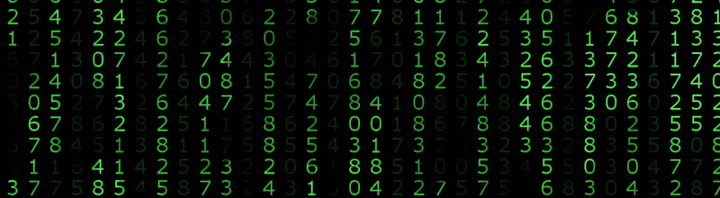

<!-- HEADER BANNER -->

 

---

### 👤 About me

<table>
  <tr>
    <td width="65%" valign="top">
      

        Hello There! I'm <b>shamjosephraj W</b>, a <b>B.E. Computer Science and Engineering</b> graduate and aspiring <b>Embedded Systems Engineer</b>.
      

      

        I have a strong foundation in <b>C programming</b>, <b>Data Structures</b>, and low-level firmware development. Currently mastering <b>ARM architectures (NXP LPC2129)</b>, peripheral interfacing (UART, I2C, SPI, Timers, PWM, ADC), and hardware-software integration.
      

      <ul>
        <li>🎓 <b>B.E. Computer Science and Engineering</b></li>
        <li>⚡ <b>Embedded Systems Engineer Trainee</b></li>
        <li>칩 <b>ARM7TDMI (LPC2129) Microcontroller Programming</b></li>
        <li>⚙️ <b>Compiler Design & C Preprocessor Development</b></li>
        <li>🌐 <b>Data Structures, Algorithms & Linux Systems</b></li>
        <li>📧 <b>Contact:</b> <a href="mailto:shamjosephraj@gmail.com">shamjosephraj@gmail.com</a></li>
      </ul>
    </td>
    <td width="35%" align="center" valign="middle">
      
    </td>
  </tr>
</table>

---

### 🌐 Connect with Me

---

### ⚙️ Technologies & Tools

&nbsp;&nbsp;

&nbsp;&nbsp;

&nbsp;&nbsp;

&nbsp;&nbsp;

&nbsp;&nbsp;

&nbsp;&nbsp;

&nbsp;&nbsp;

&nbsp;&nbsp;

&nbsp;&nbsp;

---

### 📊 Statistics

  

---

### 🌟 Featured Projects

| Project | Domain | Technologies |
|---|---|---|
| ⚙️ [**mypreprocessor**](https://github.com/shamjoes/mypreprocessor) | C Compiler Preprocessor tool: comment removal, file inclusion, and recursive macro expansion. | C99, GCC, Make |
| 🛡️ [**Cyberbullying Detection**](https://github.com/shamjoes/CYBER-BULLY-UNMASKING-USING-BERT-AND-OCR-MODEL-) | Multimodal abusive content moderation system with BERT and PaddleOCR. | Python, BERT, PaddleOCR, Flask |
| 🚗 [**Driver Drowsiness Detection**](https://github.com/shamjoes/Driver-Drowsiness-Detection-using-Deep-learning) | Safety system monitoring eye closure (EAR) and yawning frequency with automated alarms. | Python, Deep Learning, OpenCV |
| 🔍 [**OCR Text Extraction & TTS**](https://github.com/shamjoes/TEXT-EXTRACTION-AND-ENHANCEMENT-SYSTEM-ARCHITECTURE-EASY-OCR-AND-OPENCV) | End-to-end vision pipeline: image preprocessing, EasyOCR recognition, translation & TTS speech synthesis. | Python, OpenCV, EasyOCR, gTTS |
| 🎨 [**Color Blindness Assistive Vision**](https://github.com/shamjoes/Image-Processing-For-Color-Blindness-Enhancement) | Assistive real-time color detection and voice guidance for color vision deficiency. | Python, OpenCV, pyttsx3 |

---

  <i>"Passionate about writing efficient, robust code for low-level systems and embedded hardware."</i>

